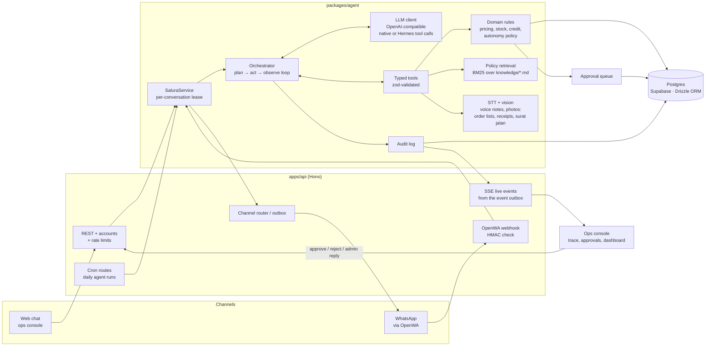
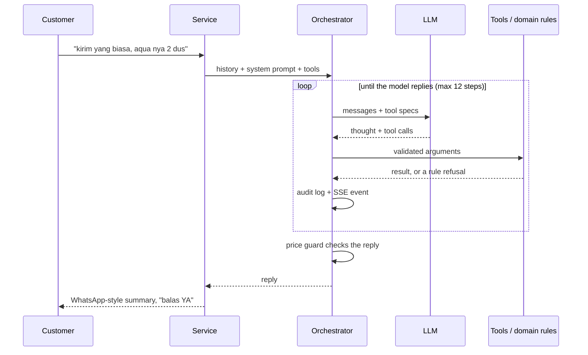

# SALURA

**Smart Agent for Line-items, Updates, Reminders & Approvals.** An AI order-desk agent for Indonesian FMCG distributors. It works inside the WhatsApp flow the distributor already has.

> **Ringkasan (Bahasa Indonesia).** Warung dan toko memesan barang ke distributor lewat WhatsApp: teks singkatan, pesan suara, atau foto daftar belanja tulisan tangan. Admin distributor biasanya mengetik ulang semuanya, mengecek stok dan limit kredit secara manual, lalu menagih pembayaran lewat chat. SALURA adalah agen AI yang mengambil alih pekerjaan itu dari pesanan sampai pembayaran. Ia membaca pesan, mencocokkan produk ke katalog, menyusun dan mengonfirmasi pesanan, menangani stok habis dan limit kredit, menyusun daftar ambil barang untuk gudang, memeriksa surat jalan dan nota, mencatat bukti transfer, menjawab pertanyaan kebijakan dari dokumen distributor, menawarkan pesan ulang, dan mengirim pengingat tagihan. Aksi berisiko masuk antrean persetujuan pemilik. Setiap langkah agen tercatat dan bisa dilihat langsung di konsol operasional.

Built for GTNIC 2026, AI Agents category ("Building Intelligent AI Agents for Enterprise Productivity").

---

> **Getting it running:** see [SETUP.md](SETUP.md) for prerequisites, every environment variable, deployment and troubleshooting.

## Contents

1. [The problem](#the-problem)
2. [Try it as a judge](#try-it-as-a-judge)
3. [Architecture](#architecture)
4. [The agent loop and its guardrails](#the-agent-loop-and-its-guardrails)
5. [Tools](#tools)
6. [Retrieval and grounding (RAG)](#retrieval-and-grounding-rag)
7. [Data model](#data-model)
8. [Evaluation](#evaluation)
9. [Run it locally](#run-it-locally)
10. [Deploy (Vercel + Supabase, or Docker)](#deploy)
11. [API](#api)
12. [Tech stack and repository layout](#tech-stack-and-repository-layout)
13. [Limitations and roadmap](#limitations-and-roadmap)

---

## The problem

Most Indonesian FMCG distributors take orders from warung and small stores over WhatsApp. The orders arrive as slang text ("indomi grg 2 dos"), voice notes and photos of handwritten lists. A sales admin re-types them, checks stock and credit by hand, and chases late payments one chat at a time.

| Pain point | Who feels it | Current workaround |
| --- | --- | --- |
| Orders arrive as slang text, voice notes and photos | Sales admin | Manual re-typing |
| Stock or credit problems found after the order is accepted | Owner, finance | Phone calls, re-negotiation |
| Delivery paperwork (surat jalan, nota) disagrees with the order | Warehouse, finance | Manual comparison, disputes |
| Late payments chased inconsistently, transfers matched by hand | Owner, finance | Ad hoc chat reminders, scrolling the bank statement |

Why this channel matters (figures as cited in our business requirements, `docs/SALURA BRD.md`):

- Traditional trade is about two-thirds of Indonesian FMCG sales (Kantar, Q1 2025: 67%).
- WhatsApp is the dominant business channel (MEF 2026: 74% prefer it for company messages).

Marketplace apps try to replace that ordering channel. SALURA automates the distributor's existing one, so the warung owner keeps chatting the way they already do.

The demo company is **CV Sumber Rejeki**, a fictional distributor in Bekasi. Its 30 products and 8 customers are synthetic (see [Limitations](#limitations-and-roadmap)). A distributor can load its own catalogue, prices, stock and customers from Excel or Google Sheets (**Impor data**).

---

## Try it as a judge

**Live demo:** _URL added at deployment._ Sign in with the **admin** account given in the proposal (it can approve and change data). A **guest** account can chat as a warung and see every screen, but not approve. A guest's chats never become real business: orders always wait for an admin, and approving anything from a guest chat (an order, a transfer receipt, an invoice correction, a question to staff) is only simulated, so no stock is reserved, no invoice is raised or paid and no staff member is messaged. Promise-to-pay dates are not saved, and a guest can queue at most 10 approvals an hour.

The ops console is in Bahasa Indonesia. **Bantuan** has the same scenarios with one-click "Coba sekarang" buttons.

1. Open **Percakapan** and pick a warung on the left, for example *Warung Bu Sari*. You are now typing as that customer.
2. Send an order the way a warung owner would:
   - `kirim yang biasa ya` takes the customer's usual order from purchase history.
   - `minyak 2 liter 1 dus` is ambiguous, so the agent asks one short question.
   - `bimoli 2 liter 6 bungkus` is out of stock, so the agent offers an approved substitute and never swaps on its own.
   - `kalau ke cikarang dikirimnya hari apa?` is answered from the distributor's policy documents, with a citation in the trace.
   - Attach a voice note or a **photo of a handwritten order list**. The agent transcribes or reads it, then handles it like a typed order.
3. Reply `ya` to the summary. The agent confirms the order, or routes it to approval when the owner's policy requires it.
4. Watch the **agent trace** next to the chat. It shows every model step: reasoning, each tool call with its arguments and result, rule refusals, and the reply that was sent.
5. Try the credit flow as *Toko Makmur Jaya*: `beras sr 10 karung`, then `ya`. The order is over the credit limit, so the agent splits it or holds it for approval.
6. **Payments.** As *Warung Bu Sari*, press **Kirim contoh bukti transfer** above the chat box (or upload any transfer screenshot when a vision model is configured). The agent reads the receipt, proposes which invoice it pays, and queues it. Nothing is marked paid until the owner checks the bank and approves in **Persetujuan**; then the customer is thanked and the invoice closes.
7. **Delivery complaint from the chat.** As *Warung Bu Sari*, press **Kirim contoh surat jalan (barang kurang)**. The agent opens a delivery check on her last delivered order, compares the document with the order and the invoice, drafts a question to the warehouse, proposes an invoice correction for the missing item and explains it to the customer.
8. Open **Persetujuan** to approve, edit or reject held orders, payments, reminders, staff questions, invoice corrections and escalations (admin account). The customer is notified automatically.
9. **Gudang** turns confirmed orders into a picking list per delivery day and area (following the 15:00 WIB cut-off in the delivery policy), printable, with "Tandai semua sudah dimuat".
10. **Pengiriman** checks delivery documents from the console: pick a shipped order, press **Pakai contoh dokumen** (or upload a photo of a surat jalan or nota).
11. **Penagihan** runs the collections agent over overdue invoices and lists the payments customers reported. Its **Mutasi bank** card matches a bank statement export (KlikBCA, Livin' Mandiri or BRI CSV) against open invoices and the transfers customers reported in the chat: **Pakai contoh mutasi** loads a sample statement for the demo data with three confident matches, one line that needs a decision and one unrelated transfer. Every proposal lists the rules behind it; nothing changes until the owner confirms, and uploading the same statement again records nothing twice. **Ringkasan** shows orders handled, the straight-through rate, errors caught and minutes saved, plus the proactive reorder agent (**Pesan ulang otomatis**). All of it is computed from the database.
12. **Impor data** loads products, units, prices, stock and customers from a CSV file or a Google Sheets link, with a row-by-row check before anything is saved.

**Pengaturan → Reset data demo** (admin) restores the starting data. The public demo also resets itself after a period without activity.

---

## Architecture



- **Channels.** Web chat is the channel judges can test. WhatsApp runs through [OpenWA](https://github.com/rmyndharis/OpenWA), a self-hosted gateway. Both channels feed the same `SaluraService.handleInbound`, and replies go back out on the channel the customer used.
- **Service.** Stores the inbound message, builds the conversation history (the last 12 messages), picks the system prompt and toolset, and runs the agent. Runs are queued per conversation, so replies never interleave.
- **Orchestrator.** A planner/executor loop. The model plans and chooses tools. The runtime validates the arguments, executes the tool, writes every step to the audit log, and feeds the results back until the model writes a reply.
- **Domain layer.** All business rules are plain TypeScript functions over the database: price tiers, unit conversion, stock reservation, credit, the owner's autonomy policy, reminder spacing. The model cannot bypass them, because tools only call these functions.
- **Live trace.** Every audit entry is also written to an `events` outbox table and streamed to the console over Server-Sent Events, so the console shows the agent's work as it happens, even when the run and the browser's stream are served by different serverless instances.
- **Deployment.** The console is static files on Vercel's CDN; the whole API is one Vercel Function (Hono, bundled with esbuild) in Singapore next to the Supabase Postgres database. Everything a long-running server would keep in memory lives in Postgres instead: media, the live event stream, rate-limit counters, per-conversation locks, sessions. The daily agents run from Vercel Cron. The same code also runs as a normal Node server (local development, Docker).

---

## The agent loop and its guardrails



A typical order takes several tool calls. The agent reads the profile, matches every product phrase in one catalog search, drafts the order, reads the issues the draft reports (out of stock, over credit, low confidence) and either asks the customer or adapts. It confirms only after the customer agrees.

| Guardrail | Where | What it does |
| --- | --- | --- |
| **Validation gate** | `orchestrator.ts` | Every tool call is checked against its zod schema before it runs. Invalid JSON or arguments go back to the model as a readable error, so it can fix the call. |
| **Business rules** | `domain/*.ts` | Prices always come from the price list, never from the model. Units must be valid for the product, and stock is re-checked and reserved at confirmation. A refusal is returned to the model as data, not as a crash. |
| **Consent guard** | `confirmOrder`, `markSummarySent` | An order is confirmed only if the customer was actually sent the current version of it (by a run that finished normally, or an approved offer) and replied afterwards. A reply after a failed run never counts as consent. |
| **Overdue hold** | `confirmOrder`, `splitOrder` | Orders from a customer with an invoice more than 14 days overdue are held whole for the owner; splitting cannot be used to get around it. |
| **Autonomy policy** | `autonomy_policies` table, **Pengaturan** | The owner chooses per action (confirm order, over-credit order, send reminder, offer a reorder) whether the agent acts on its own, needs approval, or only suggests. Orders above a set amount always need approval. |
| **Price guard** | `orchestrator.ts` | Before a reply is sent, every amount in it (`Rp118.000`, `118.000`, `245rb`, `Rp1,2 jt`) must match a money field some tool returned during the run; rounded shorthand of a real figure is allowed. Numbers the customer said or wrote (voice transcripts, photo text) do not count. If the check fails, the reply is held and the model is asked to rewrite it once. A second failure escalates to a human. |
| **Retry, then escalate** | `orchestrator.ts` | When a tool fails unexpectedly twice in one run, the step limit (12) or the 90-second run deadline is reached, or the model is unreachable, the run is escalated to a human. The customer still gets a polite holding reply. Runs cut off by a restart or a killed instance are found by a sweep (still "running" 3 minutes after they started) and recovered the same way. |
| **Human approval queue** | `approvals` table, **Persetujuan** | Holds orders, credit overrides, payments, reminders, reorder offers, staff questions, invoice corrections and escalations, each with its reason and the agent trace. Pending orders show current stock per line. The owner can approve, edit lines or reject, and the customer is notified. |
| **Money never moves on the agent's word** | `domain/payments.ts` | A transfer receipt only creates a *proposal*: the amount, which invoices it pays (oldest first, or the ones the customer named), any overpayment. Invoices change only when the owner approves after checking the bank (by hand, or by confirming a match from the uploaded bank statement); a second copy of a pending proof is refused, and so is a receipt for a transfer already confirmed from the statement. An invoice is never paid beyond its amount: the rest of a transfer, or a correction that takes an invoice below what was paid, is listed under **Penagihan → Lebih bayar** until the owner marks it refunded. |
| **Concurrency** | `service.ts`, `domain/*.ts` | One run at a time per conversation across all server instances (a lease row in Postgres; a message waiting for it does not hold one of the run slots). Stock is checked and reserved in one conditional `UPDATE`, so two orders can never take the same units. Approval decisions lock their row, so a double click decides once. |
| **Scope guard** | system prompt + `allowedMessageIds` | Tools can only read media from the current conversation. Unknown numbers cannot place orders and are escalated instead. Off-topic requests are steered back to ordering. |
| **Public-surface limits** | `app.ts`, `rate-limit.ts`, `service.ts` | Counters live in Postgres, so they hold across serverless instances. Per client IP: 80 messages per 10 minutes, 40 per conversation, 5 new phone numbers per hour. At most 4 agent runs at once per instance, with a wait list of 8; beyond that new messages get a 503 and are not stored. Uploads limited to 4 MB and to allowed audio and image types (the console shrinks photos first); live-event connections capped per IP. |
| **Accounts** | `auth.ts`, `users`, `sessions` | Everything is behind a login. Passwords are hashed with scrypt; the session cookie is HttpOnly, SameSite=Lax and Secure in production, and only its SHA-256 is stored. Admin accounts decide approvals and change data; guest accounts can chat and look. Their chats are a sandbox: guest messages, drafts, orders, runs, payment claims and delivery checks are flagged and kept apart from the customer's own. Every guest order waits for an admin, and approving a guest's order, payment, invoice correction or staff query is simulated (the decision is recorded and answered in the guest chat; no stock, invoice, payment or staff WhatsApp changes). Guest rows stay out of the picking list, collections, credit, reorder rhythm, customer history, dashboard metrics and bank-statement matching, and are marked "Chat uji tamu" on Pesanan, Penagihan and Persetujuan. No promise-to-pay is saved, and a guest can queue at most 10 approvals an hour per device (reserved atomically). Failed logins are throttled per IP; state-changing requests from another origin are refused. |
| **Database exposure** | `migrations/0001_enable_rls.sql` | Supabase publishes the `public` schema through its REST API. Row level security is on for every table with no policies, so that API reads nothing; the app connects as the table owner. |
| **WhatsApp webhook** | `channels.ts` | Off unless OpenWA is configured; then only HMAC-signed deliveries are accepted, redeliveries are ignored and media is size- and type-checked. A message SALURA is too busy to answer is stored and handed to an admin, never dropped. |
| **Audit log** | `audit_log` table | Append-only record of every customer message, thought, tool call, result, refusal, approval and reply, with timings. Token usage and cost are stored per run. |

---

## Tools

Order desk (`packages/agent/src/tools/order-tools.ts`):

| Tool | Purpose | Side effect |
| --- | --- | --- |
| `get_customer_profile` | Store, tier, credit, usual order, recent orders, open invoices, open draft | read |
| `transcribe_audio` | Speech-to-text for a voice note in this conversation (result cached on the message) | read |
| `read_order_image` | Reads a photo from the chat with a vision model and says what it is: an order list (one line per item), a transfer receipt (amount, date, bank, reference) or a delivery document. Unreadable words are marked `[?]`; the result is cached | read |
| `search_catalog` | Matches free-text product phrases to products, with confidence, units, purchase history and an ambiguity flag | read |
| `check_stock` | Available stock (on hand minus reserved) | read |
| `check_credit` | Whether an amount fits the remaining credit | read |
| `draft_order` | Creates or replaces the draft and prices it from the tier price list. Reports out-of-stock lines (with approved substitutes), over-credit and low-confidence lines | write |
| `confirm_order` | Confirms after customer consent. Re-checks stock and credit and applies the autonomy policy. Result: confirmed, awaiting approval, or blocked over credit | write |
| `split_order` | Confirms the part that fits the credit limit and holds the rest for approval | write |
| `request_approval` | Holds the whole order for the owner, with a reason | write |
| `cancel_order` | Cancels the open draft | write |
| `record_promise_to_pay` | Records the date a customer promises to pay an invoice | write |
| `record_payment` | Records a payment the customer reports (usually a transfer receipt) and proposes which open invoices it pays; queued for the owner to check against the bank | write |
| `report_delivery_problem` | Opens a delivery check for a surat jalan or nota photo sent in the chat, against the customer's latest delivered order; the delivery tools below then run in the same conversation | write |
| `search_policies` | Retrieves policy sections (delivery, cut-off, returns, payment, service) with citation ids | read |
| `escalate_to_human` | Hands the conversation to the order desk with a reason | write |

Proactive sales (`proactive-tools.ts`, run daily at 08:00 WIB or from **Ringkasan**):

| Tool | Purpose | Side effect |
| --- | --- | --- |
| `get_reorder_candidates` | Customers with a regular ordering rhythm: usual order, average days between orders, days since the last one, and a `skipReason` (open draft, invoice >14 days overdue, offered in the last 7 days, not due yet) | read |
| `send_reorder_nudge` | Prepares the usual order as a priced draft (out-of-stock items left out) and an approved message asking the customer to reply YA. Sends it or queues it per policy | external |

Delivery checks (`delivery-tools.ts`, run from **Pengiriman**, or inside a chat after `report_delivery_problem`):

| Tool | Purpose | Side effect |
| --- | --- | --- |
| `read_delivery_document` | Reads the photographed surat jalan or nota with a vision model (keeps document number, prices, handwritten corrections like `5 → 4`) | read |
| `search_catalog` | Maps document lines to products | read |
| `compare_delivery` | Deterministic comparison per product: ok, short, missing, over, not ordered, price differences; value of undelivered goods; amount the invoice overcharges | write |
| `draft_staff_query` | WhatsApp question to the warehouse or driver about the difference, sent when the owner approves | external |
| `propose_invoice_adjustment` | Lowers the invoice by the computed value of undelivered goods (owner approval), releases reserved stock, tells the customer | write |

Collections (`collection-tools.ts`, run daily at 09:00 WIB or from **Penagihan**):

| Tool | Purpose | Side effect |
| --- | --- | --- |
| `get_overdue_invoices` | Overdue invoices with days overdue, preferred tone, promise-to-pay date and last reminder | read |
| `draft_reminder` | Builds a reminder from an approved template in the chosen tone. Sends it or queues it per policy. Refused if the customer was reminded in the last 3 days or a promise-to-pay date has not passed | external |

---

## Retrieval and grounding (RAG)

SALURA grounds its answers in three sources. None of them rely on the model's memory.

1. **Policy documents (BM25).** `packages/agent/knowledge/*.md` holds the distributor's own rules: delivery days per area, order cut-off, small orders, warehouse pickup, returns, payment methods and terms, credit, substitutions and service hours. They are split into one chunk per `##` section, each with a stable citation id such as `pengiriman#jadwal-pengiriman-per-area`. Queries are tokenized with Indonesian stopwords and suffix stripping, then expanded with customer vocabulary (`penyok → rusak, retur`, `transfer → pembayaran`), and ranked with BM25. The prompt requires the agent to answer policy questions only from the returned sections. The evaluation checks that the right section was retrieved.
2. **Catalog matching.** Product phrases are normalized (typos such as `indomi → indomie`, units such as `dos → dus` and `renteng → renceng`, sizes such as `seliter → 1l`) and matched against product names and synonyms with a blend of word-level and character-trigram similarity. Each candidate gets a confidence score. When two candidates are too close, the match is flagged ambiguous.
3. **Purchase history.** When a phrase is ambiguous but the customer has bought only one of the close candidates before, the result includes a `historyHint`. The agent uses it and tells the customer which product it assumed. "Yang biasa" resolves to the customer's usual order, which is computed from past orders.

Every figure the agent quotes then has to pass the price guard described above.

---

## Data model

Postgres through Drizzle ORM (`packages/db/src/schema.ts`, migrations in `packages/db/migrations`). Production runs on Supabase; tests and the evaluation run on PGlite, the same Postgres compiled to WebAssembly, with a fresh in-memory database per test or eval run.

| Area | Tables |
| --- | --- |
| Catalog | `products`, `product_units` (dus/pcs/renceng/karung conversions), `product_prices` (per tier), `product_synonyms`, `product_substitutes`, `stock` (on hand and reserved) |
| Customers and money | `customers` (tier, credit limit, payment terms, preferred reminder tone), `invoices` (due date, paid amount, promise-to-pay), `payments` (reported transfers, proposed allocation, owner decision), `bank_statement_lines` (statement credit lines the owner matched or set aside, unique by a hash of date, amount and description so a re-upload is idempotent) |
| Orders and delivery | `orders` (draft → awaiting customer → confirmed / awaiting approval / rejected / cancelled; shipped time), `order_items` (raw text, match confidence, substitution), `delivery_checks`, `staff` |
| Control | `autonomy_policies`, `approvals`, `reminders`, `settings` |
| Conversation and memory | `messages` (text, media id, transcript or photo text), `media` (voice notes and photos), `conversation_state`, `conversation_locks` |
| Observability | `agent_runs` (trigger, status, steps, tokens, cost), `audit_log` (also human data changes), `events` (live outbox), `eval_reports` |
| Platform | `users`, `sessions`, `rate_limits` |

Memory works on two levels. Short-term memory is the recent conversation, including cached transcripts and photo text. Long-term memory is structured: purchase history, the usual order, open drafts, invoices and promises to pay. The agent reads it through tools rather than from an ever-growing prompt.

---

## Evaluation

`packages/eval` replays a fixed dataset against the real model, each case in a fresh seeded database with a fixed clock. A case is graded by **inspecting the database the agent wrote to**, not by reading its text: which order lines were processed, their final status, whether an escalation, promise-to-pay or delivery note was recorded, and which policy section was retrieved.

60 cases in 14 categories: simple orders, slang and typos, "yang biasa", ambiguous items, out of stock with substitution, over credit, payments (promise to pay, transfer receipts recorded for the owner and never marked paid, partial payments applied oldest first, asking for proof when none is given), policy questions, escalation, voice notes, photographs (order lists, and photos that are neither an order nor a receipt), cancellation, the proactive reorder run (who must be offered, who must be skipped), and delivery documents (catch the shortfall from the console or from a customer's chat complaint, no false alarm on a matching one).

Each case runs **k** times (default 5). The report gives the pass rate (pass@1), **pass^k** (the share of cases that passed in all k runs, which measures reliability, not luck), item accuracy, seconds per turn and cost per case. Voice and photo cases use stored transcripts, so the evaluation measures the agent rather than the speech or vision provider.

```bash
pnpm eval                          # all cases, k=5
pnpm eval -- --k 3 --category photo --category voice
pnpm eval -- --case s01 --case a02
pnpm eval -- --publish             # store the report where the deployed console reads it
```

The evaluation needs `LLM_API_KEY`, and it exits with a clear message without one. Results are written to `packages/eval/results/latest.json` (gitignored). With `--publish` the report is also stored in `DATABASE_URL`, and the **Evaluasi** page and the dashboard of the deployed console show it. The unit and integration tests (`pnpm test`) use a scripted model and need no key.

---

## Run it locally

Requirements: Node.js 22+ and pnpm 11 (`corepack enable`). No database server is needed: without `DATABASE_URL` SALURA runs an embedded Postgres (PGlite) in `./data/pglite`.

```bash
pnpm install
cp .env.example .env      # then fill in the keys below
pnpm dev                  # API on http://localhost:8787 (creates and seeds the database, prints generated passwords)
pnpm --filter @salura/web dev   # console on http://localhost:5173, proxied to the API
```

Or run it the production way, with one process and one port:

```bash
pnpm build                # builds the console into apps/web/dist
pnpm start                # API + console on http://localhost:8787
```

Configuration (`.env`, every variable is described in `.env.example` and [SETUP.md](SETUP.md)):

| Variable | Purpose |
| --- | --- |
| `LLM_BASE_URL`, `LLM_API_KEY`, `LLM_MODEL` | Any OpenAI-compatible chat endpoint. The default is Nous Portal with `deepseek/deepseek-v4.1-flash` |
| `LLM_TOOL_MODE` | `native` (OpenAI `tool_calls`) or `prompt` (`<tool_call>` blocks parsed by SALURA). `pnpm check:llm` tells you which works |
| `LLM_PRICE_INPUT_PER_M`, `LLM_PRICE_OUTPUT_PER_M` | USD per 1M tokens, for cost per order. Leave blank to skip cost |
| `STT_API` | `transcriptions` (Whisper endpoint) or `chat` (multimodal model taking `input_audio`). Nous Portal has no Whisper endpoint, so it needs `chat` |
| `STT_BASE_URL`, `STT_API_KEY`, `STT_MODEL` | The speech provider. `chat` mode reuses the Nous key with `openai/gpt-audio-mini` and accepts only wav/mp3; the console converts its recordings |
| `VISION_BASE_URL`, `VISION_API_KEY`, `VISION_MODEL` | OpenAI-compatible `/chat/completions` with a vision model, for photos (order lists, receipts, surat jalan) |
| `DATABASE_URL` | Postgres URL (Supabase: the transaction pooler, port 6543). Blank = embedded PGlite in `./data/pglite` |
| `ADMIN_PASSWORD`, `VIEWER_PASSWORD` | Passwords for the `admin` and `tamu` accounts, created on first start. `pnpm user add <name> <admin\|viewer>` adds more |
| `CRON_SECRET` | Shared secret Vercel Cron sends to the daily agent routes |
| `AGENT_SCHEDULE` | `off` disables the daily 08:00 reorder offers and 09:00 reminders (long-running server) |
| `DEMO_RESET_IDLE_MINUTES` | For the public demo: reset the synthetic data after this many idle minutes (0 = never) |
| `MANUAL_MINUTES_PER_ORDER` | Baseline for "minutes saved" (default 6) |
| `OPENWA_*` | WhatsApp channel (optional) |

Without `LLM_API_KEY` the console still works, and every agent run escalates to a human safely. Without STT or vision keys, voice notes and photos fall back to the transcripts stored with the bundled samples (the evaluation and the chat sample buttons use them); other uploads are escalated.

Tests and type checks:

```bash
pnpm test                          # vitest: domain rules, agent loop (scripted model), API, on an in-memory Postgres
npx tsc -p tsconfig.json           # backend and tests
npx tsc -p apps/web/tsconfig.json  # console
```

---

## Deploy

### Vercel + Supabase (the public demo)

1. **Database.** Create a Supabase project (region Singapore). Copy the **Transaction pooler** connection string (Project → Connect; port 6543, user `postgres.<project-ref>`). The direct `db.<ref>.supabase.co` host is IPv6-only and Vercel cannot reach it. URL-encode special characters in the password.
2. **Schema and data**, from your machine with that URL in `.env`:
   ```bash
   pnpm db:migrate     # creates the tables (and turns on row level security)
   pnpm db:reset       # loads the demo distributor
   ```
3. **Vercel project.** Import the repository. `vercel.json` sets the install and build commands; the build (`scripts/build-vercel.mjs`) writes the Build Output API: the console as static files, the API as one Node function in `sin1`, routes, and two crons (08:00 and 09:00 WIB).
4. **Environment variables** (Production): `DATABASE_URL`, `LLM_*`, `STT_*`, `VISION_*`, `ADMIN_PASSWORD`, `VIEWER_PASSWORD`, `CRON_SECRET`, `DEMO_RESET_IDLE_MINUTES=60`, and `ENABLE_EXPERIMENTAL_COREPACK=1` so Vercel uses the pnpm version pinned in `package.json`.
5. Deploy, open the URL and sign in. Put the URL in this README.

The function never migrates on start-up: run `pnpm db:migrate` against the same `DATABASE_URL` before deploying a version with a new migration.

### Docker (any server)

```bash
cp .env.example .env               # set DATABASE_URL (or leave it blank for the embedded database), LLM_API_KEY, ADMIN_PASSWORD, ...
docker compose up -d --build       # http://localhost:8787
```

The image is multi-stage. The build stage installs the workspace with pnpm and builds the console. The runtime stage runs the API with `tsx` as the non-root `node` user, keeps the embedded database (when used) in the `/app/data` volume, and has a healthcheck on `/health`. The API serves the console from the same origin.

### WhatsApp via OpenWA (optional)

OpenWA keeps a WhatsApp Web session open, so it needs an always-on server (not Vercel).

```bash
docker compose --profile whatsapp up -d --build
docker exec openwa-api cat /app/data/.api-key   # OpenWA admin key, generated on first boot
```

1. Open the OpenWA dashboard at `http://localhost:2785`, create a session, and scan the QR code with the distributor's WhatsApp number.
2. Put `OPENWA_API_KEY` and `OPENWA_SESSION_ID` (and a `OPENWA_WEBHOOK_SECRET` of your choice) in `.env`, then run `docker compose up -d` again.
3. Register the webhook: `POST http://localhost:2785/api/sessions/<session>/webhooks` with header `X-API-Key`, and body `{"url": "http://salura:8787/webhooks/openwa", "events": ["message.received"], "secret": "<OPENWA_WEBHOOK_SECRET>"}`.

OpenWA's README does not document the webhook payload or the signature header name. SALURA's parser accepts the common whatsapp-web.js shapes and checks an HMAC-SHA256 of the body in `x-openwa-signature`, `x-webhook-signature` or `x-signature`. Check both against your instance's Swagger (`/api/docs`) before going live.

---

## API

All endpoints are JSON under `/api` and need a signed-in session (cookie from `POST /api/auth/login`), except login itself, `/health`, the cron routes (cron secret) and the WhatsApp webhook (HMAC).

| Method and path | Purpose |
| --- | --- |
| `POST /api/auth/login` · `/logout` · `GET /api/auth/me` | Sign in (`{username, password}`), sign out, current account |
| `GET /api/conversations` · `/:waId/messages` · `/:waId/profile` · `/:waId/trace` | Conversation list, messages, customer card, recent agent runs with steps |
| `POST /api/conversations/:waId/messages` | Customer message: JSON `{text}` or multipart `file` (audio/image) with an optional `text` caption. Runs the agent |
| `GET /api/chat-samples` · `POST /api/conversations/:waId/sample` | Bundled sample photos (transfer receipt, surat jalan) and sending one as the customer |
| `POST /api/conversations/:waId/admin-reply` (admin) | Admin answers the customer directly: `{text}` → `{message}` |
| `GET /api/approvals?status=` · `POST /api/approvals/:id/approve` (admin) · `/reject` (admin) | Approval queue. Approve accepts `editedLines`, reject needs a `note` |
| `GET /api/orders` · `/api/orders/:id` | Orders with lines, customer and approvals |
| `GET /api/orders/:id/correction` (admin) | Whether a confirmed order can still be withdrawn, plus the draft notice for the customer |
| `POST /api/orders/:id/cancel` (admin) | Withdraws a confirmed order: releases its stock, removes its invoice, tells the customer. `{reasonCode, note?, message?}` |
| `POST /api/orders/:id/restore` (admin) | Undo for the above: re-reserves stock, raises a fresh invoice, tells the customer to ignore it |
| `GET /api/runs` · `/api/runs/:id/trace` | Agent runs and their audit trail |
| `GET /api/dashboard` | Metrics computed from stored data |
| `GET /api/collections/overdue` · `POST /api/collections/run` (admin) · `GET /api/payments` · `GET /api/collections/overpaid` · `POST /api/collections/overpaid/:source/:id/settle` (admin) | Overdue invoices, the collections agent, reported payments, overpayments to settle |
| `GET /api/deliveries` · `POST /api/deliveries/:orderId/check` (admin) · `GET /api/deliveries/checks/:id` | Delivery document checks |
| `GET /api/warehouse/picking` · `POST /api/warehouse/ship` (admin) | Picking list per delivery day and area; mark orders loaded |
| `GET /api/bank-statement/sample` · `POST /api/bank-statement/preview` (admin) · `/apply` (admin) | Bank statement matching: CSV upload (`file`, plus `selections` as JSON on apply), `{csv}` or `{sample: true}`. Preview returns every credit line with its status (`confident`, `review`, `none`, `recorded`) and scored candidates with reasons; apply takes `selections: [{hash, candidateId \| null}]` and records everything in one transaction |
| `GET /api/import/:dataset/template` · `POST /api/import/:dataset/preview` (admin) · `/apply` (admin) | Spreadsheet import (`produk`, `satuan`, `harga`, `stok`, `pelanggan`): CSV upload, `{csv}` or `{sheetUrl}` |
| `GET /api/proactive/candidates` · `POST /api/proactive/run` (admin) | Reorder candidates with skip reasons, and the proactive agent |
| `GET /api/settings/autonomy` · `PUT /api/settings/autonomy/:action` (admin) | Autonomy policy |
| `POST /api/admin/reset` (admin) · `GET /api/users` (admin) | Demo reset, accounts |
| `GET /api/events` | Server-Sent Events from the event outbox: audit entries, messages, runs, approvals (resumes with `Last-Event-ID`) |
| `GET /api/cron/:job` | `proactive`, `collections`, `maintenance`; needs `Authorization: Bearer $CRON_SECRET` |
| `POST /webhooks/openwa` | WhatsApp inbound |
| `GET /health` | Liveness |

(admin) = needs an admin account; guest accounts get 403.

---

## Tech stack and repository layout

TypeScript (ESM) on Node.js 22 in a pnpm workspace. API: Hono with `@hono/node-server`, deployed as a Vercel Function (Build Output API, esbuild bundle). Data: Postgres (Supabase in production, PGlite for tests and the evaluation) with Drizzle ORM and `postgres.js`. Validation: zod, which also generates the tool JSON schemas. LLM: any OpenAI-compatible endpoint, by default Nous Portal (`deepseek/deepseek-v4.1-flash`) with native function calling, or prompt-based tool calls. Speech and vision: OpenAI-compatible providers. Console: React 19, React Router, TanStack Query, Tailwind CSS 4, Motion, Vite. Tests: Vitest.

```
apps/
  api/          Hono app: REST, accounts, SSE, OpenWA webhook, rate limits, spreadsheet import, cron routes;
                server.ts (long-running) and vercel.ts (serverless) entries
  web/          Ops console (Bahasa Indonesia): login, chat + live trace, approvals, orders, warehouse, deliveries,
                collections and payments, evaluation, settings, data import
packages/
  agent/        Orchestrator, service, prompts, LLM clients, tools, domain rules, STT, vision, policy retrieval
    knowledge/  Distributor policy documents (the RAG corpus)
  db/           Drizzle schema, migrations, synthetic seed data
  eval/         Dataset, grader, runner (pass^k)
scripts/        build-vercel.mjs (Vercel Build Output)
docs/           BRD, PRD, technical specification, competition context
```

---

## Limitations and roadmap

Known limitations:

- **Synthetic data.** The distributor, its 30 products, 8 customers, prices, invoices and policies are invented for the demo. No real distributor data is used. Real data can be loaded through **Impor data**.
- **No user validation yet.** We have not yet interviewed real distributors. Problem figures beyond the cited market statistics are hypotheses, and so is the 6-minute manual baseline behind "minutes saved". It is a setting, not a measurement.
- **OpenWA is unofficial.** It automates WhatsApp Web, which WhatsApp does not officially support, and numbers can be restricted. It also needs an always-on server, so the Vercel demo uses the web chat. A production deployment should use the WhatsApp Business Platform (Cloud API) behind the same channel interface. OpenWA's webhook payload fields are not yet verified against a running instance.
- **Single tenant.** One distributor per database. More would need per-tenant isolation (a tenant column with row level security, or a schema per tenant).
- **Bank statements are uploaded, not connected.** The owner downloads the mutation CSV from internet banking and uploads it; matching is rule-based (invoice number, exact amount, a sum of open invoices, owner name, WhatsApp number, reported chat transfers) and the owner confirms each match. A bank API would remove the download step.
- **Retrieval is lexical.** BM25 and trigram matching work well for a small, Indonesian-specific corpus and catalog. A larger catalog would benefit from embeddings alongside them.

Roadmap: WhatsApp Cloud API, a bank API instead of statement uploads, sync back to the distributor's accounting system, per-customer reminder schedules, multi-tenant hosting, and pilots with real distributors.
# SALURA
